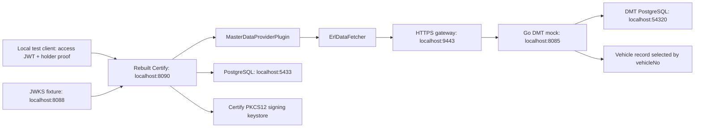

# DMT ERL: Local Deployment and Testing Plan

Test helpers were moved on 2026-10-11 to the separate sibling Git repository [dmt-certify-test-kit](../../../dmt-certify-test-kit/README.md). Generated lab state also lives in that repository's ignored `.local/dmt/` directory. Commands below run from the Inji Certify checkout and load the kit environment.

Prepared: 2026-10-09  
Applies to: the Java 21 / Spring Boot 3.2.3 checkout and its `dmt-dataprovider-plugin` module.  
Related design: [multi-endpoint-plan.md](multi-endpoint-plan.md).  
Status: deployed on this workstation on 2026-10-09 (Asia/Colombo). See section 17 for the recorded results and section 16 for lifecycle commands. The lab uses synthetic data and a JWT fixture; a real OAuth/wallet deployment remains separate.

## 1. What this local exercise proves

Deploy the **rebuilt Certify application from this checkout** on the host, PostgreSQL in Docker, a local JWT/JWKS fixture, and the provided Go DMT mock behind an HTTPS gateway. Submit an ERL request with a signed access token and a separately signed holder proof. Check that Certify selects the ERL configuration, calls the correct vehicle endpoint, formats the four fields, and signs a VC.

The access-token fixture represents the authorization server's side of the contract. It is not an implementation of login, OAuth authorization-code exchange, consent, or real vehicle-ownership checks. Production entitlement checking still belongs to the authorization server.



| Component | Address | Purpose |
| --- | --- | --- |
| Certify JVM | `http://localhost:8090/v1/certify` | Issuance, metadata and credential configuration |
| PostgreSQL container | `127.0.0.1:5433` | Certify persistence and key-manager tables |
| Local JWKS server | `http://localhost:8088/jwks.json` | Access-token signature verification |
| HTTPS gateway | `https://localhost:9443` | Forwards vehicle calls to Go; serves custom context and local issuer DID |
| Go DMT mock | `http://127.0.0.1:8085` | Adapted lab copy of the provided Go API, backed by its existing DB |
| DMT PostgreSQL | `localhost:54320` | Existing `dmt-postgres` container and synthetic ERL records |
| Holder key | Local file | Signs the `openid4vci-proof+jwt` proof |
| Access-token signing key | Different local file | Signs fixture access tokens |
| Certify signing keys | Certify-generated PKCS12/database records | Signs the issued VC |

These three signing-key roles are different. The DMT TLS certificate is a fourth, unrelated key.

### Important repository constraints

- Use a newly built `certify-service` JAR. The published `inji-certify-with-plugins:0.14.0` image does not contain this checkout's selected-scope handoff or the new DMT plugin. Adding only the plugin to that older image is insufficient.
- **Do not activate Spring profile `local` for the signed-token exercise.** [LocalAccessTokenValidationFilter.java](../../certify-service/src/main/java/io/mosip/certify/filter/LocalAccessTokenValidationFilter.java) replaces normal bearer-token claims with demo claims. This guide copies its configuration values into an external base file but runs the profile `dmt-dev`; [AccessTokenValidationFilter.java](../../certify-service/src/main/java/io/mosip/certify/filter/AccessTokenValidationFilter.java) then validates real signed JWTs.
- `MasterDataProviderPlugin` needs `_certifySelectedScope` from the patched issuance service and `credential_lookup.vehicleNo` from the authenticated token. The wallet must not supply a vehicle in the request body as a substitute.
- Loading the DMT plugin JAR and scanning `lk.gov.dmt.certify.plugin` are both necessary. `LoggerAuditService` is already included in Certify at `io.mosip.certify.plugin.impl`; no external mock plugin JAR is needed.
- An endpoint returning JSON does not prove VC signing or independent verification. Follow the separate gates below.

## 2. Prerequisites and workspace

Install or make available:

- JDK 21 (`java`, `jar`, `keytool`) and Maven.
- Docker Engine/Desktop with the daemon running.
- Python 3.9+ with `venv` and `pip` (3.9 was exercised on this workstation).
- Go 1.25+ for the supplied mock.
- OpenSSL with `req -addext` support, `curl`, and optionally `jq`.
- Internet access for Maven/Python dependencies and standard VC/security JSON-LD contexts, unless those contexts have already been made available through a validated local cache.

Run commands from the repository root. Substitute the checkout location if different:

```sh
cd /Users/bathiya/GovTech/inji-certify-my-fork/inji-certify
export REPO_ROOT="$PWD"
export TEST_KIT_ROOT="$(cd ../dmt-certify-test-kit && pwd)"
export CERTIFY_REPO="$REPO_ROOT"
export LAB_DIR="$TEST_KIT_ROOT/.local/dmt"
sdk use java 21-local
export DMT_MOCK_ROOT="/Users/bathiya/GovTech/dmt-mock-api"
python3 "$TEST_KIT_ROOT/scripts/prepare_lab.py"
source ../dmt-certify-test-kit/.local/dmt/env.sh
mkdir -p "$LAB_DIR/config" "$LAB_DIR/plugins" "$LAB_DIR/certs" "$LAB_DIR/keys" "$LAB_DIR/scripts" "$LAB_DIR/output"
java -version
mvn -version
docker version
openssl version
```

Use the VS Code terminal profile **Certify Java 21 (SDKMAN)**. This workspace disables jEnv's conflicting prompt hook only in that profile. In another terminal, jEnv may overwrite SDKMAN's `JAVA_HOME`; verify `mvn -version` immediately before building. The prepared `env.sh` also pins host processes to SDKMAN's installed `21-local`; set `DMT_JAVA_HOME` before preparation if your Java 21 installation has a different identifier.

The supplied mock was found at `../../dmt-mock-api` from this nested checkout, rather than `../dmt-mock-api`. `prepare_lab.py` checks both locations or uses `DMT_MOCK_ROOT`. It copies the source into `../dmt-certify-test-kit/.local/dmt/go-mock`, changes the route/query from subject to vehicle, binds the Go listener to loopback, and removes API-key logging. The original Go project is preserved.

The `../dmt-certify-test-kit/.local/dmt/` directory now contains the deployed lab state and is excluded by the test kit's `.gitignore`. Keep its private keys, tokens and keystore private. The reusable scripts in the sibling `dmt-certify-test-kit/scripts/` repository contain no private keys or generated bearer tokens.

In every new terminal, run `source ../dmt-certify-test-kit/.local/dmt/env.sh`. The commands below use that file to locate the lab and select the intended Java runtime. Preparing the lab refreshes configuration/source copies while preserving keys and databases; restart processes after any configuration change.

Install the test-client dependencies in an isolated environment:

```sh
python3 -m venv "$LAB_DIR/venv"
"$LAB_DIR/venv/bin/python" -m pip install 'PyJWT[crypto]>=2.10,<3' 'PyLD>=2,<3'
"$LAB_DIR/venv/bin/python" -m pip freeze > "$LAB_DIR/output/python-dependencies.txt"
```

This installs the RSA/JWK functionality used by the fixture. Record the resolved versions for reproducible reruns. [PyJWT's RSA examples](https://pyjwt.readthedocs.io/en/stable/usage.html#encoding-decoding-tokens-with-rs256-rsa) require its cryptography dependency.

## 3. Gate A: run tests and build the changed artifacts

```sh
mvn -B -ntp -pl dmt-dataprovider-plugin -am test -Dgpg.skip=true
mvn -B -ntp -pl certify-service -am test -Dtest=CertifyIssuanceServiceImplTest -Dsurefire.failIfNoSpecifiedTests=false -Dgpg.skip=true
mvn -B -ntp -pl certify-service,dmt-dataprovider-plugin -am install -DskipTests -Dgpg.skip=true
```

The first command runs the plugin/registry/HTTPS fixture tests. The second checks the selected-scope handoff in the issuance service. The third builds and installs the rebuilt application and plugin; it does not repeat the tests.

Expected artifacts:

```text
certify-service/target/certify-service-0.14.0.jar
certify-integration-api/target/certify-integration-api-0.14.0.jar
dmt-dataprovider-plugin/target/dmt-dataprovider-plugin-0.14.0.jar
```

Copy the DMT plugin only to the external loader directory:

```sh
cp dmt-dataprovider-plugin/target/dmt-dataprovider-plugin-0.14.0.jar "$LAB_DIR/plugins/"
```

Retain `mosip.certify.integration.audit-plugin=LoggerAuditService`. Its implementation is built into the rebuilt service, so the loader directory contains **only** `dmt-dataprovider-plugin-0.14.0.jar`. Do not download or add `mock-certify-plugin` for audit support: it is unnecessary and adds unrelated classes/dependencies.

```sh
jar tf certify-service/target/certify-service-0.14.0.jar | rg 'plugin/impl/LoggerAuditService'
unzip -p certify-service/target/certify-service-0.14.0.jar META-INF/MANIFEST.MF | rg 'Main-Class|Start-Class'
```

The executable application should use Spring Boot's `PropertiesLauncher` because the service POM uses `layout=ZIP`. Never place the standalone integration API JAR or an older Certify service JAR in the loader directory: the rebuilt executable already contains its API dependency.

**Pass condition:** both test commands pass, the rebuilt executable exists, and the loader directory contains the intended plugin JARs. Do not interpret Maven dependency-download failures as application failures.

## 4. Gate B: create an isolated PostgreSQL database

Use a dedicated container and volume. Choose another name/port if these already exist; do not run initialization scripts against a shared database.

```sh
docker run --detach --name dmt-certify-db \
  --publish 127.0.0.1:5433:5432 \
  --env POSTGRES_DB=inji_certify \
  --env POSTGRES_USER=postgres \
  --env POSTGRES_PASSWORD=postgres \
  --mount "type=bind,src=$REPO_ROOT/db_scripts/inji_certify,dst=/schema,readonly" \
  --volume dmt-certify-db-data:/var/lib/postgresql/data \
  postgres:16-alpine

docker exec dmt-certify-db pg_isready -U postgres -d inji_certify
```

Wait until `pg_isready` reports acceptance. The password is a disposable loopback-only lab value.

On a **fresh** database, create its schema and load the current repository DDL/DML:

```sh
docker exec dmt-certify-db psql -U postgres -d inji_certify -v ON_ERROR_STOP=1 \
  -c 'CREATE SCHEMA certify; ALTER DATABASE inji_certify SET search_path TO certify,pg_catalog,public;'
docker exec -w /schema dmt-certify-db psql -U postgres -d inji_certify -v ON_ERROR_STOP=1 -f ddl.sql
docker exec -w /schema dmt-certify-db psql -U postgres -d inji_certify -v ON_ERROR_STOP=1 -f dml.sql
docker exec dmt-certify-db psql -U postgres -d inji_certify -c '\dt certify.*'
docker exec dmt-certify-db psql -U postgres -d inji_certify -c 'SELECT app_id,is_active FROM certify.key_policy_def ORDER BY app_id;'
```

Working directory `/schema` is necessary for the DML's relative CSV path. Database search path is necessary because some DDL statements use unqualified table names. Do not rely on the outdated `db_scripts/mosip_certify` paths in `application-local.properties`.

Do not also execute `docker-compose/docker-compose-injistack/certify_init.sql`: it has its own schema reset and sample credential inserts. This guide deliberately uses the current `db_scripts/inji_certify` tree.

**Pass condition:** Certify/key-manager tables exist and policies include `ROOT`, `CERTIFY_SERVICE`, `CERTIFY_PARTNER`, `CERTIFY_VC_SIGN_ED25519`, RSA and EC applications. Initialization is not an idempotent migration; on a rerun, retain the initialized database rather than repeating `CREATE TABLE` and policy imports.

## 5. Gate C: HTTPS mock certificate and Java trust

The plugin enforces HTTPS and normal certificate/hostname checks. Generate a test certificate for `localhost`:

```sh
openssl req -x509 -newkey rsa:2048 -sha256 -nodes -days 365 \
  -keyout "$LAB_DIR/certs/dmt-key.pem" \
  -out "$LAB_DIR/certs/dmt-cert.pem" \
  -subj '/CN=localhost' \
  -addext 'subjectAltName=DNS:localhost,IP:127.0.0.1'
chmod 600 "$LAB_DIR/certs/dmt-key.pem"
```

Create a lab truststore containing the JDK's existing trusted CAs **plus** the mock certificate. Keeping the existing CAs is necessary for standard external JSON-LD contexts:

```sh
keytool -importkeystore -noprompt \
  -srckeystore "$JAVA_HOME/lib/security/cacerts" -srcstorepass changeit \
  -destkeystore "$LAB_DIR/certs/truststore.p12" -deststoretype PKCS12 -deststorepass local-trust-pass
keytool -importcert -noprompt -alias dmt-localhost \
  -file "$LAB_DIR/certs/dmt-cert.pem" \
  -keystore "$LAB_DIR/certs/truststore.p12" -storetype PKCS12 -storepass local-trust-pass
```

Use your distribution's actual source truststore password if different. These commands create a separate truststore; they do not modify the installed JDK. Do not disable TLS validation or use HTTP for the DMT route.

## 6. Prepare the JWT keys and JWKS fixture

Use [prepare_keys.py](../../../dmt-certify-test-kit/scripts/prepare_keys.py). It generates distinct RSA access/holder keys, preserves existing keys, sets private-key file permissions, and produces public JWKS/JWK files.

Run the key generator, then copy only the public JWKS into a dedicated serving directory. The managed start command in section 9 starts the HTTP server:

```sh
"$LAB_DIR/venv/bin/python" "$TEST_KIT_ROOT/scripts/prepare_keys.py"
mkdir -p "$LAB_DIR/jwks-public"
cp "$LAB_DIR/keys/jwks.json" "$LAB_DIR/jwks-public/jwks.json"
```

For foreground diagnosis instead of managed startup, run `"$LAB_DIR/venv/bin/python" -m http.server 8088 --bind 127.0.0.1 --directory "$LAB_DIR/jwks-public"` in a separate terminal. Do not combine foreground and managed processes on the same ports.

The directory served by the fixture contains only `jwks.json`; keep all private key files in the unserved `keys` directory. After section 9 starts the services, test it:

```sh
curl --fail http://localhost:8088/jwks.json
```

The HTTP JWKS URL is confined to this host-local fixture. The DMT endpoint uses HTTPS. For a real authorization server, configure its real issuer and JWKS addresses and let it issue the signed custom claim.

## 7. Prepare the provided Go mock and HTTPS gateway

The original Go API has `GET /api/v1/erl/subjects/{subject}` over HTTP. The plugin's agreed contract is `GET /api/v1/erl/vehicles/{vehicleNo}` over HTTPS. `prepare_lab.py` adapts **only the lab copy**: it registers the vehicle route and uses the parameterized SQL predicate `WHERE vehicle_no = $1`. The fixture's subject column is not a vehicle entitlement check; the JWT generator represents that separate authorization-server responsibility.

Start the supplied mock database, preserving its existing state:

```sh
# On this workstation the existing dmt-postgres container was reused.
docker start dmt-postgres
# On a fresh workstation, create only the database from the supplied Compose file:
# docker compose -f "$DMT_MOCK_ROOT/docker-compose.yaml" up -d postgres

docker exec dmt-postgres pg_isready -U dmt_user -d dmt_db
docker exec dmt-postgres psql -U dmt_user -d dmt_db \
  -c 'SELECT subject,vehicle_no,chassis_no,issue_date,expire_date FROM erl_records ORDER BY subject;'
```

Expected source records:

| Vehicle | Chassis | Issue date | Expiry date |
| --- | --- | --- | --- |
| `WP-ABC-1234` | `CHASSIS000001` | `2026-01-01` | `2026-12-31` |
| `WP-CAB-5678` | `CHASSIS000002` | `2026-02-15` | `2027-02-14` |

Do not start the original `dmt-erl-mock-api` container alongside the lab copy; both use port 8085. Build the lab copy:

```sh
(cd "$LAB_DIR/go-mock" && GOCACHE="$LAB_DIR/go-cache" go build -o dmt-mock-api .)
```

[The HTTPS gateway](../../../dmt-certify-test-kit/scripts/gateway.py) forwards vehicle requests to the loopback Go listener and preserves its HTTP error status. It also serves `/contexts/erl.json` and `/issuer/did.json`. The latter mirrors Certify's generated verification keys and changes `assertionMethod` to explicit key references. That normalization is confined to this fixture; verification here does not prove the unmodified Certify DID document is verifier-compatible.

The prepared environment uses `DMT_API_BASE_URL=https://localhost:9443`, the Go mock's test API key, issuer `http://localhost:8088`, and scan package `lk.gov.dmt.certify.plugin`. Keep the HTTP Go listener behind the TLS gateway; Certify continues to perform normal HTTPS certificate and hostname checks.

The managed start command in section 9 launches Go, JWKS, gateway and Certify together. For foreground diagnosis, use these in separate terminals after sourcing the lab environment:

```sh
"$LAB_DIR/go-mock/dmt-mock-api"
"$LAB_DIR/venv/bin/python" "$TEST_KIT_ROOT/scripts/gateway.py"
```

After startup, check the vehicle and context routes:

```sh
curl --fail --cacert "$LAB_DIR/certs/dmt-cert.pem" \
  -H "X-API-Key: $DMT_API_KEY" \
  https://localhost:9443/api/v1/erl/vehicles/WP-ABC-1234
curl --fail --cacert "$LAB_DIR/certs/dmt-cert.pem" https://localhost:9443/contexts/erl.json
```

**Pass condition:** both calls succeed; vehicle data comes from the Go API/database. JVM trust is exercised during issuance. The DID is populated after credential registration.

## 8. Configure the external `dmt-dev` profile

`prepare_lab.py` copies `application-local.properties` as an external **base** file without activating `local`, imports the plugin YAML, and installs the following reviewed profile from [application-dmt-dev.properties](../../../dmt-certify-test-kit/scripts/application-dmt-dev.properties):

```properties
spring.config.import=dmt-provider.yml
spring.cloud.config.enabled=false
spring.cloud.config.import-check.enabled=false
server.address=127.0.0.1
server.port=8090
server.servlet.path=/v1/certify
spring.mvc.servlet.path=${server.servlet.path}
mosip.hostname=localhost
mosip.certify.domain.url=http://localhost:8090
mosipbox.public.url=http://localhost:8090

spring.datasource.url=jdbc:postgresql://localhost:5433/inji_certify?currentSchema=certify
spring.datasource.username=postgres
spring.datasource.password=postgres
spring.jpa.hibernate.ddl-auto=none
spring.sql.init.mode=never

mosip.certify.plugin-mode=DataProvider
mosip.certify.integration.scan-base-package=${CERTIFY_INTEGRATION_SCAN_PACKAGES}
mosip.certify.integration.data-provider-plugin=MasterDataProviderPlugin
mosip.certify.integration.audit-plugin=LoggerAuditService

mosip.certify.authorization.url=http://localhost:8088
mosip.certify.authn.issuer-uri=${DMT_IDENTITY_ISSUER}
mosip.certify.authn.jwk-set-uri=http://localhost:8088/jwks.json
mosip.certify.authn.allowed-audiences={'http://localhost:8090/v1/certify/issuance/credential'}
mosip.certify.authn.filter-urls={'/v1/certify/issuance/credential','/v1/certify/issuance/vd11/credential','/v1/certify/issuance/vd12/credential'}
mosip.certify.identifier=http://localhost:8090
mosip.certify.authorization.default-server=http://localhost:8088
mosip.certify.credential-config.as-mapping={"ERLCredential":"http://localhost:8088"}
mosip.certify.cnonce-expire-seconds=300

mosip.kernel.keymanager.hsm.keystore-type=PKCS12
mosip.kernel.keymanager.hsm.config-path=${LAB_DIR}/keys/certify.p12
mosip.kernel.keymanager.hsm.keystore-pass=dmt-local-keystore-pass
mosip.certify.data-provider-plugin.did-url=did:web:localhost%3A9443:issuer
mosip.certify.data-provider-plugin.issuer-public-key-uri=https://localhost:9443/issuer/did.json
mosip.certify.data-provider-plugin.rendering-template-id=
mosip.certify.issuer.ledger-enabled=false
management.endpoints.web.exposure.include=health,info
management.endpoint.health.show-details=never

# Use valid MVC patterns for the loopback-only lab.
mosip.certify.security.ignore-auth-urls=/actuator/**,/error,/credential-configurations/**,/.well-known/**,/issuance/**,/system-info/**
mosip.certify.security.ignore-csrf-urls=/actuator/**,/error,/credential-configurations/**,/.well-known/**,/issuance/**,/system-info/**
logging.level.root=INFO
logging.level.org.springframework=INFO
logging.level.io.mosip=INFO
```

The base configuration retains existing cache, crypto-suite, proof-algorithm and key-manager properties. This avoids trying to reconstruct the entire service configuration from a plugin-only example.

The imported YAML configures `trusted-issuer`, API key and the route `/api/v1/erl/vehicles/{vehicleNo}`. Confirm it still enables only ERL. Spring's external config locations, profile files and imports determine precedence; the plugin selector in the profile and imported fragment must agree. [Spring Boot external configuration](https://docs.spring.io/spring-boot/docs/3.2.3/reference/html/features.html#features.external-config)

The loopback lab profile explicitly permits its configuration/discovery endpoints and leaves issuance token validation to the real signed-token filter. It overrides the copied `**/…/**` patterns, which otherwise caused `PatternParseException` and HTTP 500 with the current MVC matcher. This guide binds the app to loopback and uses only disposable data. It is not a production security configuration.

## 9. Start the rebuilt Certify JVM

For the prepared lab, start all four host processes with PID records and separate logs:

```sh
source ../dmt-certify-test-kit/.local/dmt/env.sh
"$LAB_DIR/venv/bin/python" "$TEST_KIT_ROOT/scripts/manage.py" start
"$LAB_DIR/venv/bin/python" "$TEST_KIT_ROOT/scripts/manage.py" status
```

The manager refuses to use ports occupied by an untracked process. Its `start` command is idempotent for its live recorded processes; it does not start Docker containers or wait for readiness. Logs are under `$LAB_DIR/output/{certify,go-mock,jwks,gateway}.log`. Use the health checks below before proceeding.

For foreground Certify diagnosis, the equivalent command is:

```sh
java \
  -Dloader.path="$LAB_DIR/plugins" \
  -Dspring.profiles.active=dmt-dev \
  -Dspring.cloud.config.enabled=false \
  -Djavax.net.ssl.trustStore="$LAB_DIR/certs/truststore.p12" \
  -Djavax.net.ssl.trustStoreType=PKCS12 \
  -Djavax.net.ssl.trustStorePassword=local-trust-pass \
  -jar certify-service/target/certify-service-0.14.0.jar \
  --spring.config.location="file:$LAB_DIR/config/" \
  --spring.profiles.active=dmt-dev
```

JVM options must precede `-jar`. The explicit system property and application argument override the checkout's bootstrap default profile. The config-server client is disabled for this lab; it must not overwrite the local fixture's issuer, scan packages or routes.

Check startup output:

1. Active profile is `dmt-dev`; **`local` must not appear**.
2. PostgreSQL connects to port 5433.
3. No competing `DataProviderPlugin` beans are reported.
4. `MasterDataProviderPlugin`, its registry and the audit implementation are available.
5. Key initialization completes (`CERTIFY KEY SETUP COMPLETED` / started message).
6. No HTTPS, missing-secret or missing-strategy validation errors appear.

The key manager creates/uses the lab PKCS12 file and generates the issuer keys using the database policies. Keep its keystore and database together across restarts.

Check health and discovery:

```sh
curl --fail http://localhost:8090/v1/certify/actuator/health
curl --fail http://localhost:8090/v1/certify/.well-known/openid-credential-issuer
```

The ERL metadata is not expected yet; it is registered in the next section. If the app fails before health is available, diagnose startup rather than continuing to token/proof tests.

## 10. Register the ERL credential configuration

Use [prepare_erl_config.py](../../../dmt-certify-test-kit/scripts/prepare_erl_config.py). It creates the reviewed Velocity template and credential configuration with the three VC/ERL/security contexts, scope `dmt_erl`, actual Certify Ed25519 key-manager IDs and localhost issuer DID. It escapes identifier strings using the formatter's Velocity escape tool.

Generate and register the configuration:

```sh
"$LAB_DIR/venv/bin/python" "$TEST_KIT_ROOT/scripts/prepare_erl_config.py"
curl --fail-with-body -X POST http://localhost:8090/v1/certify/credential-configurations \
  -H 'Content-Type: application/json' \
  --data-binary "@$LAB_DIR/output/erl-config.json"
curl --fail http://localhost:8090/v1/certify/credential-configurations/ERLCredential
curl --fail http://localhost:8090/v1/certify/.well-known/openid-credential-issuer
curl --fail --cacert "$LAB_DIR/certs/dmt-cert.pem" https://localhost:9443/issuer/did.json
```

On a rerun where `ERLCredential` already exists, use `PUT /v1/certify/credential-configurations/ERLCredential` with the same file rather than duplicate `POST`. Use the configuration API instead of direct SQL so the service's cache invalidation applies.

**Pass condition:** creation returns HTTP 201 (or update 200), discovery advertises ERL with scope `dmt_erl` and format `ldp_vc`, and the local DID document exposes the actual Certify signing key. The fixture's `/issuer/did.json` mirrors Certify's public keys and publishes explicit `assertionMethod` references to them; it does not create a replacement signing key.

The DMT document's `issueDate` and `expireDate` remain credential-subject fields. Certify's `issuanceDate` and `expirationDate` come from its own credential validity settings.

## 11. Generate a signed token and holder proof

Use [issue_request.py](../../../dmt-certify-test-kit/scripts/issue_request.py). The fixture issues signed access JWTs with `credential_lookup.vehicleNo`, a matching client/nonce, and a separately signed holder proof. Its synthetic user is entitled to the two listed vehicles; it refuses other vehicles in normal mode. This entitlement map is a test fixture, not an integration with real ownership records.

Negative cases include missing lookup, invalid number, incorrect issuer/audience/scope/nonce, expiry, and `tampered-lookup`. The tamper case changes the JWT vehicle payload **after signing**, keeping the original signature, so authentication must reject it. `forged-selection` signs the reserved selection claim and confirms that Certify overwrites it with validated metadata.

Generate the normal request immediately before sending it:

```sh
"$LAB_DIR/venv/bin/python" "$TEST_KIT_ROOT/scripts/issue_request.py" WP-ABC-1234
```

Important values based on this checkout's validators:

| Value | Required relationship |
| --- | --- |
| Access JWT `iss` | Matches `mosip.certify.authn.issuer-uri` and DMT `trusted-issuer` |
| Access JWT signature | Verifies against `/jwks.json`; `kid=dmt-access-test` |
| Access JWT `aud` | Contains the issuance endpoint in `allowed-audiences` |
| Access JWT `client_id` | Present; here `dmt-test-wallet` |
| Access JWT `iat`/`exp` | Issued before now; not expired |
| Access JWT `c_nonce` | Same nonce as holder proof; positive `c_nonce_expires_in` |
| Holder proof header `typ` | `openid4vci-proof+jwt` |
| Request `proof.proof_type` | **`jwt`**, not the header's `typ` value |
| Holder proof `aud` | Matches `mosip.certify.identifier`: here `http://localhost:8090` |
| Holder proof `iss` | If included, equals access JWT `client_id` |
| Holder proof key | Public JWK in header; private key remains on the client |
| Vehicle lookup | Nested signed claim `credential_lookup.vehicleNo` |

The fixture puts a nonce in the signed access token because this checkout can obtain the initial nonce from those claims. If Certify returns a new `c_nonce` (for example due to expiry/cache state), sign a fresh holder proof using the returned nonce and the **same access token**. Replacing the access token changes its hash and therefore its cache transaction. There is no assumption of a separate `/nonce` endpoint in this guide.

## 12. Gate D: issue and inspect the ERL VC

```sh
export ACCESS_TOKEN="$(cat "$LAB_DIR/output/access-token.txt")"
curl --silent --show-error \
  -D "$LAB_DIR/output/issuance.headers" \
  -o "$LAB_DIR/output/issuance-response.json" \
  -w '%{http_code}\n' \
  -X POST http://localhost:8090/v1/certify/issuance/credential \
  -H "Authorization: Bearer $ACCESS_TOKEN" \
  -H 'Content-Type: application/json' \
  --data-binary "@$LAB_DIR/output/credential-request.json"
```

Use `Bearer`, not `TestBearer`. The wallet request identifies the credential type and supplies holder proof; it does not contain `vehicleNo` in its body.

Expected results:

1. HTTP 200 and a response `credential` object for `ldp_vc`.
2. Mock receives `GET /api/v1/erl/vehicles/WP-ABC-1234` with the configured API key.
3. Certify logs ERL/`erl`, upstream status 200, and a success outcome with correlation ID.
4. The VC subject has `vehicleNo`, `chassisNo`, `issueDate`, `expireDate`, plus Certify's holder-binding `id`.
5. The credential has an issuer and `Ed25519Signature2020` proof referencing the actual issuer key.

Inspect without mistaking proof presence for cryptographic verification:

```sh
"$LAB_DIR/venv/bin/python" - <<'CHECK'
import json
import os
from pathlib import Path
response = json.loads((Path(os.environ["LAB_DIR"]) / "output" / "issuance-response.json").read_text())
assert "credential" in response, response
vc = response["credential"]
if isinstance(vc, str):
    vc = json.loads(vc)
subject = vc["credentialSubject"]
assert subject["vehicleNo"] == "WP-ABC-1234"
assert subject["chassisNo"] == "CHASSIS000001"
assert subject["issueDate"] == "2026-01-01"
assert subject["expireDate"] == "2026-12-31"
assert set(subject) == {"id", "vehicleNo", "chassisNo", "issueDate", "expireDate"}
assert vc["issuer"] == "did:web:localhost%3A9443:issuer"
proof = vc["proof"]
if isinstance(proof, list):
    proof = proof[0]
assert proof["type"] == "Ed25519Signature2020"
assert proof.get("proofValue")
(Path(os.environ["LAB_DIR"]) / "output" / "issued-erl-vc.json").write_text(json.dumps(vc, indent=2))
print("VC fields and proof structure passed; independent signature verification is still required.")
CHECK
```

Repeat with `WP-CAB-5678`; expect `CHASSIS000002`, `2026-02-15`, `2027-02-14` and the second vehicle URL. Update the assertion values accordingly. This demonstrates vehicle selection while keeping the authenticated subject `user-123` unchanged.

### If Certify returns a refreshed nonce

Keep the current access token and update only the proof in the saved request. This snippet reads the nonce from the saved response and signs a new proof with the same holder key:

```sh
"$LAB_DIR/venv/bin/python" - <<'NONCE'
import json
import os
import time
from pathlib import Path
import jwt
lab = Path(os.environ["LAB_DIR"])
response = json.loads((lab / "output" / "issuance-response.json").read_text())
nonce = response.get("c_nonce")
if not isinstance(nonce, str) or not nonce:
    raise SystemExit("No refreshed nonce in this response; inspect its error before retrying.")
request = json.loads((lab / "output" / "credential-request.json").read_text())
now = int(time.time())
proof = jwt.encode({"iss": "dmt-test-wallet", "aud": "http://localhost:8090", "iat": now - 1,
                    "exp": now + 300, "nonce": nonce},
                   (lab / "keys" / "holder.pem").read_bytes(), algorithm="RS256",
                   headers={"typ": "openid4vci-proof+jwt",
                            "jwk": json.loads((lab / "keys" / "holder-public.jwk.json").read_text())})
request["proof"]["jwt"] = proof
(lab / "output" / "credential-request.json").write_text(json.dumps(request, indent=2))
NONCE
```

Repeat the issuance curl with the same `ACCESS_TOKEN`. If that access token has expired, generate a new token/proof pair instead of reusing it.

## 13. Gate E: negative tests and extension checks

Run the automated acceptance procedure first:

```sh
"$LAB_DIR/venv/bin/python" "$TEST_KIT_ROOT/scripts/exercise.py"
```

It asserts two correct vehicle records, verifies successful signatures independently, tests VC tampering, and checks that each token/proof/lookup rejection makes zero Go mock record calls. Results are saved in `output/exercise-results.json`; reruns overwrite this synthetic evidence and generate fresh short-lived tokens. The remaining transport/configuration scenarios below are optional manual checks or automated unit-test coverage, not claims that every scenario was deployed manually.

For each manual token scenario, regenerate the fixture request, reload `ACCESS_TOKEN`, and repeat the curl command from section 12. Inspect both the response and mock logs. Use a valid proof/nonce when testing provider failures, so proof rejection does not mask the intended check.

| Scenario | How to exercise | Expected behavior |
| --- | --- | --- |
| Missing vehicle claim | `issue_request.py --case missing-lookup` | Provider fails with `INVALID_LOOKUP`; no DMT vehicle call |
| Invalid vehicle number | `issue_request.py --case invalid-number` | Reject before DMT call |
| Wrong token issuer | `issue_request.py --case wrong-issuer` | Reject during authentication; no issuance/provider call |
| Expired token | `issue_request.py --case expired` | Reject before provider dispatch |
| Wrong audience | `issue_request.py --case wrong-audience` | Reject during authentication |
| Missing ERL scope | `issue_request.py --case wrong-scope` | No matching authorized credential configuration |
| Incorrect holder nonce | `issue_request.py --case invalid-proof` | Nonce/proof error; no DMT call |
| Tampered vehicle claim | `issue_request.py --case tampered-lookup` | Authentication rejects the invalid signature; no DMT call |
| Forged selection claim | `issue_request.py --case forged-selection` | Valid ERL request still routes to ERL: Certify overwrites the reserved claim |
| Unauthorized fixture vehicle | `issue_request.py UNKNOWN-999` with default case | Token generator refuses to issue; illustrates the fixture entitlement gate |
| DMT 404 | Temporarily remove an authorized vehicle from mock records, restart mock, issue normal token | Safe data-fetch failure, not an empty/default VC |
| Wrong service API key | Give Certify a different `DMT_API_KEY` from the mock, restart Certify | DMT 401; safe data-fetch failure |
| Wrong vehicle in response | Change only mock response `vehicleNo` for the requested route, restart mock | `INVALID_RESPONSE`; no VC signed |
| Invalid ERL date order | Mock returns expiry earlier than issue date | `INVALID_RESPONSE` |
| Missing response field / array response | Modify the mock payload | `INVALID_RESPONSE` |
| Oversized response | Add a large mock response field exceeding 65,536 bytes | `RESPONSE_TOO_LARGE` |
| Timeout | Add a mock delay longer than `exchange-timeout` | `TIMEOUT`; no successful issuance |
| HTTP DMT base URL | Set base URL to `http://...`, restart Certify | Startup validation failure |
| Missing API secret | Unset API key/empty value, restart | Configuration resolution/validation failure |
| Missing strategy | Enable a route referencing an unregistered strategy | Startup fails |
| Duplicate route scope | Configure the same scope on two enabled types | Startup fails |
| Driving License requested now | No production DL strategy/config has been supplied | Unsupported request/route; no fallback to ERL |

Many transport/registry cases already have automated coverage in [DmtApiClientTest.java](../../dmt-dataprovider-plugin/src/test/java/lk/gov/dmt/certify/plugin/DmtApiClientTest.java) and [DmtPluginTest.java](../../dmt-dataprovider-plugin/src/test/java/lk/gov/dmt/certify/plugin/DmtPluginTest.java). Prefer those tests for precise timeout and body-consumption checks rather than modifying a working mock repeatedly.

Provider categories such as `INVALID_LOOKUP` appear in internal logs. The issuance service exposes the established `vci_datafetch_failed` code, not necessarily each internal category. Authentication/proof/configuration errors have their own response handling. Capture the actual status/body; do not assume every rejection is HTTP 400 or every internal code is returned to the caller.

A multi-scope token is included in the normal fixture, but a real Driving License record fetch is not implemented. Its future acceptance test needs its strategy, signed `licenseNo` lookup claim, route and registered credential configuration. The existing registry tests demonstrate extension without changing dispatch logic.

## 14. Independent VC verification and a real wallet

Run [verify_vc.py](../../../dmt-certify-test-kit/scripts/verify_vc.py) with the saved credential:

```sh
"$LAB_DIR/venv/bin/python" "$TEST_KIT_ROOT/scripts/verify_vc.py" "$LAB_DIR/output/issued-erl-vc.json"
```

This uses PyLD URDNA2015 normalization, SHA-256 proof/document hashes, and Python cryptography's Ed25519 verifier; it calls no Certify verification implementation and needs no issuer private key. It resolves the issuer DID, checks the assertion key/controller/suite, verifies the original signature, and confirms a changed vehicle number fails signature verification. Expect `PASS: original VC signature verified; altered vehicle number failed verification.`

The helper is deliberately scoped to this lab's single Ed25519Signature2020 proof and allowlisted context URLs. It checks cryptographic integrity and assertion authorization; it does not implement general wallet trust policy, revocation, credential date enforcement or every VC format. The lab adds no status list and uses current synthetic dates. A broader verifier must also enforce the intended validity/status/trust rules.

For another independent verifier, use one you run locally that supports the chosen suite. It must be able to:

1. Resolve `did:web:localhost%3A9443:issuer` to `https://localhost:9443/issuer/did.json`.
2. Trust the fixture TLS certificate.
3. Load the custom ERL context and standard VC/security contexts.
4. Locate the VC's exact `proof.verificationMethod` in the DID document and its `assertionMethod`.
5. Verify the signature using the actual Certify key and enforce its relevant validity/status rules.

Check the certificate endpoint too if the key reference does not match:

```sh
curl --fail 'http://localhost:8090/v1/certify/system-info/certificate?applicationId=CERTIFY_VC_SIGN_ED25519&referenceId=ED25519_SIGN'
```

A hosted public verifier cannot reach this workstation's `localhost`. An Inji Verify container also sees its own localhost, not the host's. Configure container DNS/host access and matching SANs/DID URLs, or use a trusted reachable HTTPS hostname. Do not upload a localhost-dependent credential to a public verifier and interpret resolution failure as a signing failure.

The existing repository Compose stack provides optional Mimoto/Inji Web/Verify services. Add them only after the direct issuance gates work. To exercise a real wallet, onboard `ERLCredential`, its discovery URL, scope, contexts and issuer into the wallet/BFF, and configure a real authorization server to include the nested signed lookup claim after vehicle selection and entitlement checking. The JWKS fixture is not a full OAuth server and cannot substitute for that wallet login flow.

## 15. Troubleshooting by failing gate

| Symptom | Check |
| --- | --- |
| `Unsupported class file major version` / annotation processing error | Maven/JVM is Java 21; clean stale build outputs if they came from another JDK |
| Maven cannot resolve an artifact | Network/cache/repository access; use normal online Maven before assuming missing code |
| Old image reports unsupported route / missing selected scope | Run the rebuilt executable with the patched handoff, not the published base image |
| No `DataProviderPlugin` bean | Loader path, plugin JAR contents, scan package, selector |
| Multiple provider beans | DMT selector must override `MockCSVDataProviderPlugin`; inspect exact loaded plugin annotations |
| Audit bean missing | Use the built-in `io.mosip.certify.plugin.impl.LoggerAuditService` and retain its selector; no external mock JAR needed |
| `Unsupported proof type` | Request uses `proof_type: jwt`; JWT header uses `typ: openid4vci-proof+jwt` |
| `Local Validator Enabled` in logs | Remove `local` from active profiles and restart |
| Token accepted but no `credential_lookup` | Confirm actual profile/token and that the real authorization server includes the nested claim |
| `INVALID_LOOKUP` before network | Nested claim/object/string types, canonical vehicle format and exact template variable |
| `IDENTITY_ISSUER_MISMATCH` | DMT client's trusted issuer differs from JWT issuer |
| JWT validation fails | Correct signing key/kid/JWKS, issuer, audience, client_id, iat/exp and system clock |
| Nonce error | Regenerate fresh fixtures, or sign a new proof with returned nonce using the same access token |
| `PKIX path building failed` | Truststore path/type/password; local certificate imported and standard CAs preserved |
| Hostname verification fails | Use the certificate's SAN hostname (`localhost`) consistently |
| `Connection refused` | Mock/JWKS/DB not running, wrong port, or host/container addressing confused |
| URI unexpectedly contains `/base/...` | Client base URL path is intentionally prefixed; use the configured root URL for this mock |
| Missing DB relation | Correct schema/search path; current DDL initialized; no reliance on obsolete datasource schema paths |
| Key policy/certificate error | DML policies, PKCS12 directory permissions, DB and keystore consistency |
| No ERL discovery entry | Register the credential configuration via the API; plugin YAML does not create it |
| Signing fails fetching context | HTTPS fixture running, certificate trusted, standard contexts reachable |
| Signature verification fails | Exact public key/key ID/assertion method, resolvable DID/context and verifier suite support |

## 16. Evidence, shutdown and completion criteria

Keep only synthetic-test evidence in `$LAB_DIR/output`:

- Maven test summaries and resolved tool/dependency versions.
- Successful configuration API response and ERL discovery entry.
- Redacted startup log showing the intended profile and key initialization.
- Mock evidence of the exact requested vehicle URL.
- Issued VC and independent verification result.
- Negative-case response bodies and confirmation of absent DMT calls where expected.

Do not share bearer tokens, holder/access private keys, API secrets or the Certify keystore.

For managed processes, stop only the recorded lab host processes:

```sh
source ../dmt-certify-test-kit/.local/dmt/env.sh
"$LAB_DIR/venv/bin/python" "$TEST_KIT_ROOT/scripts/manage.py" stop
```

The manager checks the recorded process command before signalling its PID. For foreground processes, use Ctrl+C. Stop the lab databases without deleting state:

```sh
docker stop dmt-certify-db dmt-postgres
```

On a rerun, source `../dmt-certify-test-kit/.local/dmt/env.sh`, run `docker start dmt-certify-db dmt-postgres`, and run `manage.py start`. Preserve the matching Certify keystore. Use `manage.py restart-certify` after profile/plugin changes. Reuse the initialized DB and update the credential configuration if necessary. Regenerate short-lived tokens/proofs each time.

Only intentionally remove the dedicated container/volume and corresponding lab keystore when you want a full reset; that is separate from routine shutdown. Never apply schema reset scripts to another environment.

**Local deployment is complete when:** automated tests pass, the rebuilt service starts with `dmt-dev`, two vehicle selections retrieve two correct ERL records, malformed/unauthorized requests fail before issuance, the actual issued VC verifies independently, and no real identity/vehicle data was needed.

## 17. Deployment record (2026-10-09, Asia/Colombo)

The deployment used the provided Go mock source at `/Users/bathiya/GovTech/dmt-mock-api`, adapted only in `../dmt-certify-test-kit/.local/dmt/go-mock`, and its existing PostgreSQL records. Original mock source/data were preserved.

- SDKMAN `21-local` / Java 21.0.12.1; rebuilt Certify 0.14.0 with `PropertiesLauncher`.
- 65 DMT plugin tests and 15 `CertifyIssuanceServiceImplTest` tests passed.
- Dedicated Certify PostgreSQL database initialized from current repository DDL/DML; existing DMT DB reused.
- Certify health `UP`, active profile `dmt-dev`, key setup completed, ERL registered with HTTP 201.
- Both vehicle selections and the forged-selection overwrite case returned HTTP 200. All three VCs passed independent signature checks, and altered vehicle numbers failed verification.
- All eight negative cases passed with HTTP 400 or 401 and zero Go mock record calls, including a vehicle claim modified after JWT signing.
- Detailed acceptance results and final running state are recorded in `$LAB_DIR/output/exercise-results.json`, `$LAB_DIR/output/exercise.log` and the service logs. See [deployment results](dmt-local-deployment-results.md) for the final checks.

Services remain running after deployment until stopped using section 16. The lab has no real OAuth login/consent flow; real wallet onboarding and production ownership checks are still separate work.

## Source references

- [Plugin README](../../dmt-dataprovider-plugin/README.md) and [external YAML example](../../dmt-dataprovider-plugin/examples/application.yml).
- [Data-provider SPI](../../certify-integration-api/src/main/java/io/mosip/certify/api/spi/DataProviderPlugin.java) and [issuance service](../../certify-service/src/main/java/io/mosip/certify/services/CertifyIssuanceServiceImpl.java).
- [Access-token validation](../../certify-service/src/main/java/io/mosip/certify/filter/AccessTokenValidationFilter.java), [JWT holder-proof validator](../../certify-service/src/main/java/io/mosip/certify/proof/JwtProofValidator.java), [nonce utilities](../../certify-service/src/main/java/io/mosip/certify/utils/VCIssuanceUtil.java).
- [Credential configuration controller](../../certify-service/src/main/java/io/mosip/certify/controller/CredentialConfigController.java), [key initialization](../../certify-service/src/main/java/io/mosip/certify/config/AppConfig.java), [DDL](../../db_scripts/inji_certify/ddl.sql), [DML](../../db_scripts/inji_certify/dml.sql).
- [Local development guide](../../docs/Local-Development.md), [lab scripts](../../../dmt-certify-test-kit/scripts/prepare_lab.py) and [independent verifier](../../../dmt-certify-test-kit/scripts/verify_vc.py).
- [Existing Compose setup](../../docker-compose/docker-compose-injistack/README.md), [Spring Boot external configuration](https://docs.spring.io/spring-boot/docs/3.2.3/reference/html/features.html#features.external-config), [PyJWT RSA usage](https://pyjwt.readthedocs.io/en/stable/usage.html#encoding-decoding-tokens-with-rs256-rsa), [Docker container run reference](https://docs.docker.com/reference/cli/docker/container/run/).

## 18. Ordered curl requests for testing ERL VC minting

Use this sequence against the deployed lab. All curl requests below target **Inji Certify**. The Python commands prepare the signed inputs and verify the output. The lab uses a JWT fixture: there is no fixture OAuth `/token` API to call. The configuration and discovery requests need no bearer token in this loopback lab; issuance requires the signed access token and holder proof.

### Before the API calls: load the lab environment

Run in the repository-root VS Code terminal:

```sh
cd /Users/bathiya/GovTech/inji-certify-my-fork/inji-certify
source ../dmt-certify-test-kit/.local/dmt/env.sh
export CERTIFY_BASE_URL=http://localhost:8090/v1/certify
```

The services must be running. If they were stopped, use the restart instructions in section 16 before continuing.

### 1. Check Certify health

```sh
curl --silent --show-error --fail-with-body \
  "$CERTIFY_BASE_URL/actuator/health" \
  -w '\nHTTP %{http_code}\n'
```

Expected: HTTP **200** with `{"status":"UP"}`. Stop and resolve startup errors if health is not UP.

### 2. Check the ERL configuration; create it only if missing

```sh
curl --silent --show-error \
  "$CERTIFY_BASE_URL/credential-configurations/ERLCredential" \
  -o "$LAB_DIR/output/erl-config-readback.json" \
  -w 'Configuration lookup HTTP %{http_code}\n'
```

Expected on the deployed lab: HTTP **200**. Confirm the saved configuration has scope `dmt_erl`, format `ldp_vc`, and type `ERLCredential`. If it already exists and is correct, continue to step 3.

**Only if the lookup returns 404**, prepare and create the configuration:

```sh
"$LAB_DIR/venv/bin/python" "$TEST_KIT_ROOT/scripts/prepare_erl_config.py"
curl --silent --show-error --fail-with-body \
  -X POST "$CERTIFY_BASE_URL/credential-configurations" \
  -H 'Content-Type: application/json' \
  --data-binary "@$LAB_DIR/output/erl-config.json" \
  -o "$LAB_DIR/output/registration-response.json" \
  -w 'Configuration creation HTTP %{http_code}\n'
```

Expected: HTTP **201**. Repeat the GET above to confirm it was stored. A different lookup error is not a reason to create a duplicate configuration.

**Only when intentionally updating an existing configuration**, generate the file and use PUT instead of POST:

```sh
"$LAB_DIR/venv/bin/python" "$TEST_KIT_ROOT/scripts/prepare_erl_config.py"
curl --silent --show-error --fail-with-body \
  -X PUT "$CERTIFY_BASE_URL/credential-configurations/ERLCredential" \
  -H 'Content-Type: application/json' \
  --data-binary "@$LAB_DIR/output/erl-config.json" \
  -o "$LAB_DIR/output/registration-response.json" \
  -w 'Configuration update HTTP %{http_code}\n'
```

Expected: HTTP **200**. Registration is setup work, not a step to repeat for each VC.

### 3. Check credential-issuer discovery

```sh
curl --silent --show-error --fail-with-body \
  "$CERTIFY_BASE_URL/.well-known/openid-credential-issuer" \
  -o "$LAB_DIR/output/discovery.json" \
  -w 'Discovery HTTP %{http_code}\n'
```

Expected: HTTP **200**. In `credential_configurations_supported`, `ERLCredential` must advertise scope `dmt_erl` and format `ldp_vc`. Its `credential_endpoint` should point to `http://localhost:8090/v1/certify/issuance/credential`.

### 4. Inspect the issuer's public DID and signing certificate

```sh
curl --silent --show-error --fail-with-body \
  "$CERTIFY_BASE_URL/.well-known/did.json" \
  -o "$LAB_DIR/output/certify-did.json" \
  -w 'Certify DID HTTP %{http_code}\n'

curl --silent --show-error --fail-with-body --get \
  "$CERTIFY_BASE_URL/system-info/certificate" \
  --data-urlencode 'applicationId=CERTIFY_VC_SIGN_ED25519' \
  --data-urlencode 'referenceId=ED25519_SIGN' \
  -o "$LAB_DIR/output/issuer-certificate-response.json" \
  -w 'Signing certificate HTTP %{http_code}\n'
```

Expected: HTTP **200** for both. These are diagnostic reads, not minting prerequisites to repeat for every vehicle. The independent verifier resolves the gateway's DID document, which contains the assertion-method normalization described in section 7.

### 5. Generate fresh signed inputs and mint the first vehicle's VC

First generate the access JWT and holder-proof request for `WP-ABC-1234`. The script writes both files; do not paste an expired token from an earlier test:

```sh
"$LAB_DIR/venv/bin/python" "$TEST_KIT_ROOT/scripts/issue_request.py" WP-ABC-1234
export ACCESS_TOKEN="$(cat "$LAB_DIR/output/access-token.txt")"

curl --silent --show-error --fail-with-body --max-time 45 \
  -X POST "$CERTIFY_BASE_URL/issuance/credential" \
  -H "Authorization: Bearer $ACCESS_TOKEN" \
  -H 'Content-Type: application/json' \
  --data-binary "@$LAB_DIR/output/credential-request.json" \
  -D "$LAB_DIR/output/issuance-WP-ABC-1234.headers" \
  -o "$LAB_DIR/output/issuance-WP-ABC-1234.json" \
  -w 'First vehicle issuance HTTP %{http_code}\n'
```

The generated body contains `format: ldp_vc`, `credential_definition` with the configured contexts/types, and `proof` with `proof_type: jwt` and a signed holder JWT. The vehicle number is in the access token's signed `credential_lookup.vehicleNo` claim; do not add it to the issuance request body.

Expected: HTTP **200**. The saved response contains `credential` with:

| Subject field | Expected value |
| --- | --- |
| `vehicleNo` | `WP-ABC-1234` |
| `chassisNo` | `CHASSIS000001` |
| `issueDate` | `2026-01-01` |
| `expireDate` | `2026-12-31` |

The VC also contains holder-binding `credentialSubject.id`, issuer `did:web:localhost%3A9443:issuer`, and an `Ed25519Signature2020` proof. Certify calls the Go mock through the HTTPS gateway during this request; no separate DMT call is needed from the test client.

### 6. Mint the second vehicle's VC

Generate a new access JWT and matching holder proof for the second vehicle, then call the same issuance endpoint:

```sh
"$LAB_DIR/venv/bin/python" "$TEST_KIT_ROOT/scripts/issue_request.py" WP-CAB-5678
export ACCESS_TOKEN="$(cat "$LAB_DIR/output/access-token.txt")"

curl --silent --show-error --fail-with-body --max-time 45 \
  -X POST "$CERTIFY_BASE_URL/issuance/credential" \
  -H "Authorization: Bearer $ACCESS_TOKEN" \
  -H 'Content-Type: application/json' \
  --data-binary "@$LAB_DIR/output/credential-request.json" \
  -D "$LAB_DIR/output/issuance-WP-CAB-5678.headers" \
  -o "$LAB_DIR/output/issuance-WP-CAB-5678.json" \
  -w 'Second vehicle issuance HTTP %{http_code}\n'
```

Expected: HTTP **200**, with `vehicleNo=WP-CAB-5678`, `chassisNo=CHASSIS000002`, `issueDate=2026-02-15`, and `expireDate=2027-02-14`. The fixture token subject stays `user-123`; the signed vehicle claim selects the different record.

### 7. Extract and independently verify both minted VCs

There is no Certify verification endpoint used by this lab. Extract each response's `credential` and run the independent verifier:

```sh
"$LAB_DIR/venv/bin/python" - <<'EXTRACT'
import json
import os
from pathlib import Path
output = Path(os.environ["LAB_DIR"]) / "output"
for vehicle in ("WP-ABC-1234", "WP-CAB-5678"):
    response = json.loads((output / f"issuance-{vehicle}.json").read_text())
    if "credential" not in response:
        raise SystemExit(f"No credential returned for {vehicle}; inspect its HTTP status and response.")
    vc = response["credential"]
    if isinstance(vc, str):
        vc = json.loads(vc)
    assert vc["credentialSubject"]["vehicleNo"] == vehicle
    (output / f"curl-issued-{vehicle}.json").write_text(json.dumps(vc, indent=2))
EXTRACT

"$LAB_DIR/venv/bin/python" "$TEST_KIT_ROOT/scripts/verify_vc.py" \
  "$LAB_DIR/output/curl-issued-WP-ABC-1234.json"
"$LAB_DIR/venv/bin/python" "$TEST_KIT_ROOT/scripts/verify_vc.py" \
  "$LAB_DIR/output/curl-issued-WP-CAB-5678.json"
```

Expected for each: `PASS: original VC signature verified; altered vehicle number failed verification.` A successful issuance response alone is not this verification result.

### 8. Optional: confirm a tampered vehicle claim is rejected

Generate a token whose vehicle claim was changed after signing, and send it with the otherwise valid holder proof:

```sh
"$LAB_DIR/venv/bin/python" "$TEST_KIT_ROOT/scripts/issue_request.py" WP-ABC-1234 --case tampered-lookup
export ACCESS_TOKEN="$(cat "$LAB_DIR/output/access-token.txt")"

curl --silent --show-error --max-time 15 \
  -X POST "$CERTIFY_BASE_URL/issuance/credential" \
  -H "Authorization: Bearer $ACCESS_TOKEN" \
  -H 'Content-Type: application/json' \
  --data-binary "@$LAB_DIR/output/credential-request.json" \
  -D "$LAB_DIR/output/tampered-lookup.headers" \
  -o "$LAB_DIR/output/tampered-lookup-response.json" \
  -w 'Tampered-token HTTP %{http_code}\n'
```

Expected: HTTP **401**, no VC, and no Go mock record call. To mint again afterward, regenerate normal inputs as in step 5 or 6; the current saved token/request now belongs to this negative case.

If normal issuance returns a refreshed `c_nonce` instead of a credential, copy that vehicle's saved response to `$LAB_DIR/output/issuance-response.json` (the input filename used by section 12's nonce-refresh snippet). Run that snippet with the **same access token**, repeat that vehicle's issuance curl, and save the successful response under its vehicle filename before verification. If the token itself expired, regenerate the normal token/proof pair. No separate `/nonce` API call is required for this fixture.

