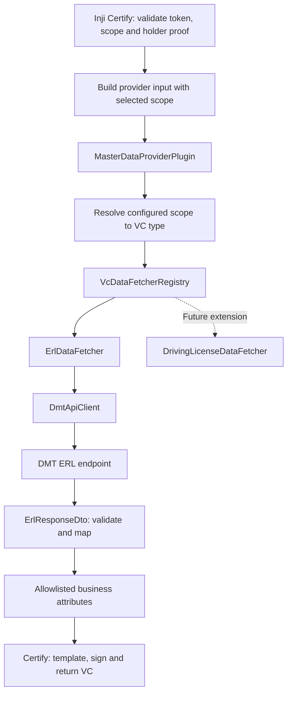

# DMT Multi-Endpoint Data Provider: Architectural Plan

Prepared: 2026-10-09  
Scope: Milestone 1 — ERL data fetching only; Driving License is a future extension.  
Baseline: This checkout uses Java 21 and Spring Boot 3.2.3.  
Status: Design reference for the implementation in progress. Java snippets describe contracts.  
Contract update: ERL uses a vehicle number from the signed token's `credential_lookup` claim.

## 1. High-Level Design & Component Architecture

Introduce one Spring-managed `MasterDataProviderPlugin` implementing Certify's existing SPI, with an immutable registry that dispatches to credential-specific strategies.



### Existing SPI and routing constraint

[DataProviderPlugin.java](../../certify-integration-api/src/main/java/io/mosip/certify/api/spi/DataProviderPlugin.java) accepts only:

```java
JSONObject fetchData(Map<String, Object> identityDetails)
    throws DataProviderExchangeException;
```

The current [CertifyIssuanceServiceImpl.java](../../certify-service/src/main/java/io/mosip/certify/services/CertifyIssuanceServiceImpl.java) passes the original claims, including the entire token scope string. It does not pass the selected credential or VC type.

Plan one generic integration change:

1. After Certify selects credential metadata and validates proof, create a fresh provider-input map.
2. Overwrite a reserved entry such as `_certifySelectedScope` with the selected metadata's scope.
3. Pass that map to the existing SPI.
4. The plugin requires this entry and checks that it belongs to the authenticated token's scopes.

This preserves the SPI signature and prevents a token containing both ERL and Driving License scopes from causing incorrect dispatch. The reserved value must come from Certify's validated selection, overwriting any same-named token claim. Future credential additions require no further changes to Certify's selection handoff or the plugin dispatcher.

Keep all credential-specific behavior inside strategies. Certify continues to own credential formatting, signing, holder binding and issuance.

## 2. Strategy & Configuration Mapping

Use three distinct identifiers:

| Identifier | Example | Purpose |
| --- | --- | --- |
| Authorized scope | `dmt_erl` | Connects Certify's selected credential to plugin configuration |
| Internal VC type | `ERL` | Registry routing key |
| Strategy ID | `erl` | Identifies a discovered fetcher implementation |

The configured route becomes:

```text
selected scope: dmt_erl
    -> configured VC type: ERL
    -> configured strategy ID: erl
    -> ErlDataFetcher
```

### Internal contract

Proposed signatures, without implementations:

```java
interface VcDataFetcher {
    String strategyId();

    VcData fetch(VcFetchRequest request)
        throws DataProviderExchangeException;
}

record VcFetchRequest(
    String vcType,
    String selectedScope,
    String subject,
    String issuer,
    String correlationId,
    Map<String, String> lookupAttributes
) {}

record VcData(Map<String, String> attributes) {}

record ErlResponseDto(
    String vehicleNo,
    String chassisNo,
    LocalDate issueDate,
    LocalDate expireDate
) {}
```

`VcData` and `VcFetchRequest.lookupAttributes` must defensively copy their maps. The master plugin converts result attributes into a fresh `JSONObject` at the SPI boundary. It validates and copies the generic `credential_lookup` object from the authenticated token; strategies decide which lookup fields they require.

Use string keys rather than a central `VcType` enum: adding a credential should not require editing a shared enumeration.

### Registry behavior

At startup, `VcDataFetcherRegistry`:

1. Discovers Spring beans implementing `VcDataFetcher`.
2. Rejects duplicate strategy IDs.
3. Builds VC-type mappings from enabled configuration entries.
4. Rejects enabled entries referencing missing strategies or API clients.
5. Rejects scopes assigned to multiple enabled VC types.
6. Publishes immutable lookup maps.

At request time, unknown or disabled routes fail before any network call. There is no default strategy, fallback to ERL, or `switch` over credential types.

### ERL lookup and response

For milestone 1, use the assumed upstream contract agreed in this session:

```text
GET /api/v1/erl/vehicles/{vehicleNo}
```

Here, `vehicleNo` comes from the signed access token's `credential_lookup.vehicleNo`. The authorization server must verify the authenticated user's entitlement to that vehicle before issuing the token. The plugin checks the configured trusted issuer and requires an exact response vehicle-number match. `sub` remains the authenticated identity; it is not a fallback lookup value.

Example decoded token claims:

```json
{
  "iss": "https://identity.example.gov.lk",
  "sub": "user-123",
  "scope": "dmt_erl",
  "credential_lookup": {
    "vehicleNo": "WP-ABC-1234"
  }
}
```

**This endpoint remains an assumption about the real DMT service.** Vehicle selection and entitlement checking belong to the authorization flow; request-body attributes and a top-level vehicle claim are not used. For the interim contract, vehicle numbers are canonical ASCII letters/digits separated by single hyphens, with a maximum length of 32. No normalization is performed; align this rule with the actual DMT format before deployment.

Expected ERL response:

```json
{
  "vehicleNo": "WP-ABC-1234",
  "chassisNo": "CHASSIS000001",
  "issueDate": "2026-01-01",
  "expireDate": "2026-12-31"
}
```

Require nonblank identifiers, ISO date parsing and `expireDate >= issueDate`. Return exactly these four business fields. Keep document dates distinct from Certify's credential issuance and validity timestamps.

## 3. Step-by-Step Code Changes Needed

Create a dedicated `dmt-dataprovider-plugin` module, using a package such as `lk.gov.dmt.certify.plugin`.

| Class/interface | Responsibility and key methods |
| --- | --- |
| `MasterDataProviderPlugin` | The sole DMT `DataProviderPlugin` bean. `fetchData(...)` validates provider input, resolves the route, delegates and converts the result to JSON. |
| `VcFetchRequest` | Immutable, validated request containing identity, routing information and generic lookup attributes. |
| `VcData` | Immutable business-attribute result with defensive copying. |
| `VcDataFetcher` | Internal strategy contract: `strategyId()` and `fetch(...)`. |
| `VcDataFetcherRegistry` | Builds immutable scope/type/strategy mappings. `resolveByScope(...)` and `getRequired(...)`. |
| `ErlDataFetcher` | Implements strategy `erl`; validates `vehicleNo`, performs vehicle lookup, checks the response vehicle matches and returns the four allowed fields. |
| `ErlResponseDto` | Typed upstream ERL response using `LocalDate` for dates. |
| `DmtApiClient` | Shared HTTP transport: configured authentication, URI construction, bounded requests and response decoding. |
| `DmtProviderProperties` | Constructor-bound configuration records for clients, credential routes and feature flags. |
| `DmtConfigurationValidator` | Cross-field validation of enabled routes, endpoint templates, durations, headers and client references. |
| `DmtPluginConfiguration` | Enables property binding and registers transport and plugin beans conditionally. |
| `DmtExchangeErrors` | Centralizes internal failure categories and safe exception construction. |

Use `MasterDataProviderPlugin` consistently; a separate `DmtDataProviderPlugin` wrapper would duplicate its role.

### Existing files to modify when implementing

- **[CertifyIssuanceServiceImpl.java](../../certify-service/src/main/java/io/mosip/certify/services/CertifyIssuanceServiceImpl.java):** add the selected-scope handoff described above, using a fresh map.
- **Root [pom.xml](../../pom.xml):** register the new module.
- **Plugin `pom.xml`:** compile against the checkout-compatible integration API; avoid bundling duplicate Certify API classes.
- **Deployment packaging:** include the plugin JAR in the existing loader path, or add its artifact to [certify-service-with-plugins/pom.xml](../../certify-service-with-plugins/pom.xml).
- **Active deployment configuration:** select the master plugin and scan its package. Preserve registration of the deployment's audit plugin. Ensure exactly one `DataProviderPlugin` bean is active.
- **New ERL credential configuration:** register its template, scope, contexts, display metadata and signing references through Certify's configuration API.

The [farmer configuration](../../certify-service/src/main/resources/credential-configurations/farmer-local-config.json) is a structural reference. Its presence in resources does not register ERL, and `pluginConfigurations` is not automatically passed to `fetchData`.

### Validation, transport and errors

#### At startup

- Bind properties using `@ConfigurationProperties`, `@Validated` and nested `@Valid`, followed by cross-field checks. Spring Boot supports this validation flow. [Spring Boot configuration validation](https://docs.spring.io/spring-boot/docs/3.2.3/reference/html/features.html#features.external-config.typesafe-configuration-properties.validation)
- Require HTTPS base URLs with valid hosts; reject user-info, query and fragment components.
- Require endpoint paths on the configured origin. Reject absolute URLs, network-path references, traversal and CR/LF, including encoded forms.
- Validate header names as HTTP tokens; reject CR/LF and control characters in values, including resolved API keys.
- Require positive, bounded timeouts and response-size limits.
- Prevent secret-bearing property records from exposing secrets through generated `toString()` output.

#### During requests

- Require exactly the configured named path variables and encode each lookup value as one URI segment; never concatenate raw lookup values into URLs.
- Verify the final URI remains on the configured origin and allowed base path.
- Use TLS certificate and hostname verification.
- Disable redirects explicitly so credentials cannot be forwarded to another endpoint. JDK `HttpClient` supports a `NEVER` redirect policy. [Java HTTP client configuration](https://docs.oracle.com/en/java/javase/21/docs/api/java.net.http/java/net/http/HttpClient.Builder.html)
- Enforce connection timeout, an exchange deadline covering response consumption, and a streaming response-size limit.
- Validate status, content type, required fields and record cardinality before returning data.
- Keep automatic retries disabled for milestone 1.

#### Error handling and logging

Translate lookup, timeout, upstream authentication, unavailable-service and invalid-response failures into `DataProviderExchangeException` with safe messages. Preserve causes using the existing exception's inherited `initCause`, or plan an additive cause-taking constructor.

The current service converts this exception using only its error code. Therefore, keep detailed internal categories in structured logs and use Certify's established data-fetch failure code externally unless the public error mapping is deliberately extended.

Log correlation ID, VC type, strategy, duration, upstream status and outcome. Exclude API keys, claims, subjects, full request URLs and response bodies.

### Planned acceptance checks

Cover registry conflicts, missing strategies, disabled routes, multi-scope routing, forged reserved claims, malformed lookup claims, missing/invalid vehicle numbers, response vehicle mismatch, generic path-variable expansion, URL/header injection, timeouts, oversized responses, invalid ERL dates and upstream errors. An issuance check should verify exactly four returned business fields and successful formatting/signing with the ERL configuration.

## 4. Required Configuration Changes (`application.yml`)

The `dmt.data-provider` namespace below is **proposed plugin configuration**, not an existing Certify feature. Endpoint paths and scopes are proposed contract values.

```yaml
mosip:
  certify:
    plugin-mode: DataProvider
    integration:
      scan-base-package: "${CERTIFY_INTEGRATION_SCAN_PACKAGES:lk.gov.dmt.certify.plugin}"
      data-provider-plugin: MasterDataProviderPlugin

dmt:
  data-provider:
    enabled: true

    clients:
      "[dmt]":
        base-url: "${DMT_API_BASE_URL}"
        connect-timeout: 2s
        exchange-timeout: 5s
        max-response-bytes: 65536
        trusted-issuer: "${DMT_IDENTITY_ISSUER}"

        authentication:
          api-key-header: X-API-Key
          api-key: "${DMT_API_KEY}"

    vc-types:
      "[ERL]":
        enabled: true
        strategy-id: erl
        authorized-scopes:
          - dmt_erl
        client-id: dmt
        endpoint-path: "/api/v1/erl/vehicles/{vehicleNo}"

      "[DRIVING_LICENSE]":
        enabled: false
        strategy-id: driving-license
```

Bracketed map keys preserve identifiers such as `DRIVING_LICENSE` during Spring property binding. Disabled entries need no strategy or endpoint until enabled.

HTTPS enforcement, redirect rejection and header validation should be mandatory invariants. Feature flags control provider and credential availability.

Supply API keys through deployment secrets resolved by environment placeholders. The plugin's configuration object should never log their values.

This checkout currently uses [application-local.properties](../../certify-service/src/main/resources/application-local.properties) and Spring Cloud configuration. Remove conflicting plugin selectors or ensure the deployment's external YAML has the intended precedence. Simply adding a classpath `application.yml` will not override profile-specific settings; `.properties` also takes precedence when both formats occupy the same location. [Spring Boot external configuration](https://docs.spring.io/spring-boot/docs/3.2.3/reference/html/features.html#features.external-config)

Separately register an ERL credential configuration whose scope is `dmt_erl`, whose template references the four ERL fields, and whose context and signing metadata match the issuer.

## 5. Future Extension Guide

To add Driving License:

1. Define its upstream lookup contract, identity authorization rules and required attributes, including the signed lookup claim (for example `licenseNo`).
2. Create `DrivingLicenseResponseDto` and `DrivingLicenseDataFetcher`, exposing strategy ID `driving-license`.
3. Register the fetcher as a Spring bean.
4. Complete the `DRIVING_LICENSE` configuration entry with its authorized scope, client and endpoint; then enable it.
5. Add another client configuration if it uses different credentials, base URL or timeouts.
6. Register the Driving License credential template, metadata, context and signing configuration.
7. Add strategy-specific validation and a routing check using a token containing both credential scopes.
8. Deploy the updated plugin and restart Certify.

`MasterDataProviderPlugin`, `VcDataFetcherRegistry`, `ErlDataFetcher` and the selected-scope handoff require no changes. Endpoint changes remain configuration-only while their request and response contracts remain compatible.
